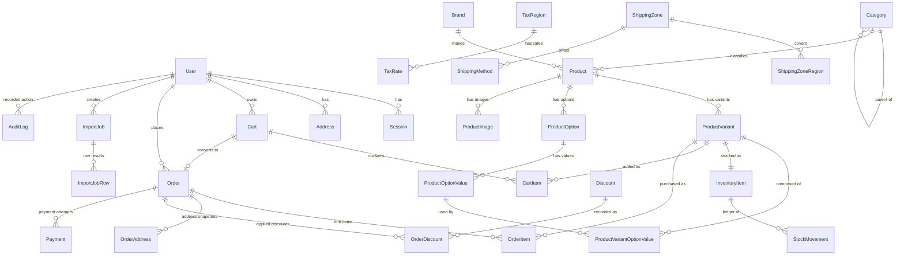

# Taek Shops — Architecture

> Status: **Phase 4 (catalogue, inventory, admin management, CSV import
> foundation) implemented.** This document is the design of record. Where a
> section describes something not yet built, it is marked _Planned_ or dated to a
> later phase. Nothing here commits the project to legal, tax, or shipping rules
> — those are operator data behind interfaces (see §11, §12).
> Security specifics: [`docs/security.md`](security.md).
> Catalogue / inventory / import specifics: [`docs/catalog.md`](catalog.md).

## 1. System context

Taek Shops is a single, deployable **Next.js (App Router) application** backed by
one **PostgreSQL** database. It serves two audiences from the same codebase:

| Actor             | Surface                         | Notes                                            |
| ----------------- | ------------------------------- | ------------------------------------------------ |
| Shopper (guest)   | Storefront                      | Browse catalogue, cart, guest checkout           |
| Customer          | Storefront + account area       | Order history, addresses, re-order               |
| Staff / Admin     | Admin dashboard                 | Catalogue, inventory, orders, spreadsheet import |
| Payment provider  | Stripe (server + webhook)       | External; behind `PaymentGateway` interface      |
| Object storage    | S3-compatible bucket + CDN      | External; behind `ObjectStorage` interface       |
| Tax provider      | Pluggable (manual or external)  | Behind `TaxCalculator` interface                 |
| Shipping provider | Pluggable (flat or carrier API) | Behind `ShippingRateProvider` interface          |

External dependencies are deliberately minimal and each sits behind a
replaceable interface so the platform is not locked to a vendor.

```
        ┌─────────────────────────── Next.js app (single deploy) ────────────────────────────┐
Browser │  Storefront (RSC)      Admin (RSC, auth-gated)      Route Handlers / Server Actions │
  ─────▶│        │                      │                              │                     │
        │        └──────────────┬───────┴───────────────┬──────────────┘                     │
        │                       ▼                       ▼                                    │
        │                 Domain services         Import pipeline                            │
        │                       │                       │                                   │
        │                       └───────── db (Prisma) ─┘                                    │
        └───────────────────────────────┬───────────────────────────────────────────────────┘
                                        ▼
                       PostgreSQL          Stripe API / webhooks
                       S3-compatible storage + CDN
```

## 2. Major application modules

| Module             | Location                       | Responsibility                                                       |
| ------------------ | ------------------------------ | -------------------------------------------------------------------- |
| Storefront         | `src/app/(storefront)/`        | Public catalogue, product pages, cart, checkout UI                   |
| Administration     | `src/app/admin/`               | Auth-gated dashboard: products, variants, inventory, orders, imports |
| Authentication     | `src/server/auth/`             | Credentials auth, DB sessions, RBAC guards, password/token handling  |
| Audit              | `src/server/audit/`            | Generic append-only audit log + metadata sanitisation                |
| User management    | `src/server/users/`            | Admin list / inspect / role / status operations (server-enforced)    |
| Domain logic       | `src/server/domain/`           | Pricing, cart, inventory, orders, tax/shipping orchestration         |
| Database access    | `src/server/db/`               | Prisma client + repositories; only module that touches the DB        |
| Validation schemas | `src/lib/validation/`          | Shared Zod schemas + inferred types                                  |
| Import processing  | `src/server/import/`           | CSV/XLSX parse → map → validate → preview → commit → audit           |
| Config             | `src/server/config/`           | Validated environment configuration (`env.ts`)                       |
| Shared UI          | `src/components/`              | Accessible, responsive component system                              |
| Infrastructure     | `infra/`, `docker-compose.yml` | Local services, deployment assets                                    |
| Tests              | `tests/unit/`, `tests/e2e/`    | Vitest unit/integration, Playwright end-to-end                       |

**Import boundaries (enforced by convention, later by lint rules):**

- `src/app/**` may import from `src/components`, `src/lib`, and `src/server`.
- `src/components/**` must not import from `src/server/**`.
- Only `src/server/db/**` imports the Prisma client.
- `src/server/config/env.ts` is the only reader of `process.env`.

## 3. Authentication & authorization model

> **Phase 3 status: implemented.** Full detail and rationale in
> [`docs/security.md`](security.md). Summary below.

- **Approach:** a custom credentials + **database-session** implementation in
  `src/server/auth/`, Auth.js-compatible in shape but not the NextAuth library
  (NextAuth's Credentials provider cannot use DB sessions, which every Phase 3
  security requirement needs — see `security.md` §1). OAuth providers slot in
  beside `authenticateWithCredentials` later.
- **Sessions:** opaque 32-byte token in an `httpOnly` `SameSite=Lax` cookie;
  only its hash is stored (`Session.tokenHash`); 30-day absolute expiry;
  validated against the DB every request (expiry + `status === ACTIVE`); role
  read fresh from the joined user row. Logout, password reset, and deactivation
  all delete session rows.
- **Passwords:** Argon2id (`@node-rs/argon2`, OWASP params). `passwordHash` is
  read by two repo functions only and omitted from every other select. Policy
  (length + blocklist + personal-info, no composition rules) in one module.
- **Roles:** `CUSTOMER < STAFF < MANAGER < ADMIN` (`UserRole` enum), hierarchical
  `ROLE_RANK` + a layered `Permission` map.
- **Enforcement points:**
  1. `src/proxy.ts` — optimistic cookie-presence redirect for `/admin` (UX only,
     Edge, no DB).
  2. Server-side guards (`requireUser` / `requireRole` / `requireAnyRole` /
     `requirePermission`) called inside every service function and route handler
     — the authoritative check.
  3. Privilege-escalation rule (`canAssignRole`) + self-role/self-status change
     blocks in `src/server/users/user-management.ts`.
- **CSRF:** Server Actions use Next's built-in Origin/Host check; hand-written
  mutating route handlers use `guardMutation()` (same-origin + double-submit
  `taek_csrf` token).
- **Audit:** every auth/security event goes through `recordAudit`
  (`src/server/audit/`), which sanitises metadata and never stores secrets.

## 4. Database architecture

> **Phase 2 status: implemented.** `prisma/schema.prisma` (29 models, 19 enums)
> and the initial migration `prisma/migrations/20260903000000_init/` exist. No
> application logic reads or writes the database yet.

- **One PostgreSQL database**, one Prisma schema, one migration history. No
  microservices, no per-module databases.
- **Prisma ORM** (`prisma` CLI 6.19.x, `@prisma/client`). Configuration in
  `prisma.config.ts`; connection string from `DATABASE_URL` (required).
- **Access rule:** application code goes through the shared client in
  [`src/server/db/client.ts`](../src/server/db/client.ts) and (from Phase 4)
  repository helpers beside it — never a second `PrismaClient`. The singleton is
  cached on `globalThis` in dev to survive HMR without leaking connections.
- **IDs:** every model uses `String @id @default(cuid())`; pure join tables use a
  composite `@@id`.
- **Money:** every monetary column is an **integer number of cents** (`Int`),
  currency-scoped by a `Currency` enum defaulting to `CAD`. Never `Float` /
  `Decimal`. `Decimal(9,6)` / `Decimal(5,4)` are used **only** for tax and
  discount _rates_ (exact fractions, e.g. `0.130000`); the domain layer converts
  a rate applied to a cents base back to integer cents.
  [`src/server/domain/money.ts`](../src/server/domain/money.ts) is the only place
  money is parsed, added, multiplied, or formatted.
- **Timestamps:** `createdAt` + `updatedAt` on mutable rows; append-only rows
  (`StockMovement`, `OrderAddress`, `OrderDiscount`, `VerificationToken`,
  `ImportJobRow`, `Session`) keep only `createdAt`.
- **History preservation:** status enums and soft flags instead of deletes for
  business records. Orders never depend on live catalogue/address rows — they
  carry snapshots (§ below). Foreign keys from history rows to mutable rows use
  `onDelete: SetNull`, so a product can be archived without destroying order
  history.
- **Migrations:** Prisma Migrate. `npx prisma migrate dev` in development,
  `npx prisma migrate deploy` in CI/production (pre-deploy step). Optional
  `DIRECT_DATABASE_URL` / `SHADOW_DATABASE_URL` for pooled / managed hosts.

### Model groups

| Group     | Models                                                                                                                               |
| --------- | ------------------------------------------------------------------------------------------------------------------------------------ |
| Identity  | `User`, `Session`, `VerificationToken`, `Address`                                                                                    |
| Catalogue | `Category`, `Brand`, `Product`, `ProductOption`, `ProductOptionValue`, `ProductVariant`, `ProductVariantOptionValue`, `ProductImage` |
| Inventory | `InventoryItem`, `StockMovement`                                                                                                     |
| Cart      | `Cart`, `CartItem`                                                                                                                   |
| Orders    | `Order`, `OrderItem`, `OrderAddress`, `OrderDiscount`, `Payment`                                                                     |
| Config    | `TaxRegion`, `TaxRate`, `ShippingZone`, `ShippingZoneRegion`, `ShippingMethod`, `Discount`                                           |
| Import    | `ImportJob`, `ImportJobRow`                                                                                                          |
| Audit     | `AuditLog` (generic, append-only; Phase 3)                                                                                           |

### Entity-relationship diagram (core entities)



## 5. Product & variant model

> **Phase 4 status: implemented.** Services in `src/server/catalog/`, admin UI at
> `/admin/catalog`, full detail in [`docs/catalog.md`](catalog.md).

A **Product** is the catalogue entity a shopper lands on. A **ProductVariant** is
the buyable unit — it carries the **SKU**, price (cents), weight, and stock.

- **Product**: `name`, unique `slug`, `description`, `status`
  (`DRAFT|ACTIVE|ARCHIVED`), `active`, `featured`, optional `categoryId` /
  `brandId`, free-text `taxCategory` _classifier_ (not a rate), `seoTitle`,
  `seoDescription`, `publishedAt`. **Product type is not an enum** — the category
  tree classifies products, so new equipment types need data, not a migration.
- **ProductVariant**: unique `sku`, optional unique `barcode`, display `name`,
  `position`, `priceCents`, optional `compareAtPriceCents` ("was" price) and
  `costCents` (internal, never sent to storefront), `currency`, `weightGrams`,
  `trackInventory`, `active`.
- **Options are normalised, not free-text or fixed columns:**
  `ProductOption` (e.g. "Size", "Colour", "Style", "Gender") →
  `ProductOptionValue` (e.g. "Small", "Red", "000") →
  `ProductVariantOptionValue` join. `@@unique([variantId, optionId])` guarantees a
  variant picks at most one value per option; `@@unique([optionId, value])` and
  `@@unique([productId, name])` keep the option catalogue clean. This supports
  arbitrary combinations (Size × Colour × …) without a uniform-specific schema.
- **No duplicate option combinations** (Phase 4): `ProductVariant.optionSignature`
  (sorted, de-duplicated join of selected `optionValue` ids) +
  `@@unique([productId, optionSignature])` enforce this at the database level.
- **Images**: `ProductImage` belongs to a product, optionally narrowed to a
  variant, with `position`, `altText`, `isPrimary`. `url` stores a _reference_
  (`storage:<key>` or an absolute URL), never binary data.

## 6. Inventory model

> **Phase 4 status: adjustment domain implemented** (`src/server/inventory/`).
> Detail in [`docs/catalog.md`](catalog.md) § "Inventory adjustment rules".
> Every stock change goes through `adjustInventory` (or the transaction-composable
> order-flow primitives) — there are no ad-hoc quantity writes.

- Each `ProductVariant` has exactly one `InventoryItem`
  (`@@unique` on `variantId`) with `quantityOnHand`, `quantityReserved`, optional
  `reorderLevel` / `reorderQuantity`. `available = onHand − reserved` is derived
  in the domain layer, not stored.
- **`StockMovement` is an append-only ledger.** Types: `INITIAL`, `PURCHASE`,
  `SALE`, `RETURN`, `ADJUSTMENT`, `RESERVATION`, `RELEASE`. Each row has a signed
  `quantityDelta`, optional `reason` / `reference` (order number, import job id)
  and optional `actorId`. The sum of deltas reconciles the `InventoryItem`
  counters; from Phase 5 the counter and the movement are written in one
  transaction.
- All quantities are integers. There is no compelling reason for fractional
  stock in this domain.
- **Reservation / oversell protection** (behaviour, added in Phase 5–6): stock is
  reserved when an order is created and committed on payment or released on
  cancellation; the reserving update is conditional (`available >= qty`) inside
  the order transaction.

## 6a. Historical order snapshots

Orders must remain accurate even after the catalogue changes:

- **`OrderItem`** stores `sku`, `productName`, `variantName`, and an
  `optionsSnapshot` JSON at purchase time, plus `unitPriceCents`, `quantity`,
  `lineSubtotalCents`, `lineDiscountCents`, `lineTaxCents`, `lineTotalCents`.
  `productId` / `variantId` are nullable references kept for convenience only.
- **`OrderAddress`** is an immutable copy of the shipping/billing address
  (`@@unique([orderId, type])`), independent of the customer's saved `Address`
  rows.
- **`OrderDiscount`** snapshots the `code`, `description`, and applied
  `amountCents`; the `discountId` link is `SetNull` on delete.
- **`Order`** freezes `subtotalCents`, `discountCents`, `shippingCents`,
  `taxCents`, `totalCents`, and `currency`, plus `status` / `paymentStatus` /
  `fulfillmentStatus` enums and `customerEmail` (so guest orders survive without
  a `User`).

## 7. Spreadsheet import pipeline

> **Phase 4 status: CSV foundation implemented** (`src/server/import/`).
> As-built behaviour, guarantees, and the Phase 4 column set:
> [`docs/catalog.md`](catalog.md) § "Product import workflow (CSV)".
> The full future spec (XLSX, column mapping, 22 columns) remains
> **`docs/product-import-specification.md`**.

Full column and rule specification: **`docs/product-import-specification.md`**.

Pipeline stages (all under `src/server/import/`):

1. **Upload** — admin-only route handler. Enforce `IMPORT_MAX_FILE_SIZE_BYTES`,
   MIME/extension allow-list (`text/csv`, `.csv`,
   `application/vnd.openxmlformats-officedocument.spreadsheetml.sheet`, `.xlsx`),
   and store the raw file in object storage under a batch id.
2. **Parse** — stream CSV (`csv-parse`) or read XLSX (`exceljs`, not `xlsx`/SheetJS)
   with a hard `IMPORT_MAX_ROW_COUNT` cap. Reject workbooks with macros.
3. **Sanitise** — neutralise **formula injection**: any cell whose value begins
   with `= + - @` or tab/CR is prefixed with `'` on export and rejected/escaped
   on import; never evaluate cell formulas.
4. **Map columns** — auto-match headings to canonical fields; present an
   override UI when headings differ. Mapping is stored with the batch.
5. **Validate** — per-row Zod schema. Collect **all** errors per row (row number,
   column, message, offending value). No partial silent coercion of prices or
   quantities.
6. **Preview** — show create / update / skip counts and a diff per row. Nothing
   is written yet.
7. **Commit** — on explicit confirmation, process in chunked transactions:
   - **Upsert by `sku`** (unique key). Modes: `create` (insert new, skip
     existing), `update` (update existing, skip new), `upsert` (both).
   - Duplicate `sku` within the same file is a hard error for that row.
   - Price and stock changes are applied via the domain services
     (`PricingService`, `InventoryService`) so `StockMovement` rows and audit
     entries are written atomically with the change.
   - A failed row does not abort the batch; it is recorded and reported.
8. **Summarise & audit** — write `ImportBatch` (status, counts, duration,
   actor, file ref) and one `ImportRow` per input row (status + errors).
   Downloadable error report (CSV) for failed rows.

**Security controls specific to import:** size/row caps (configurable, not
hard-coded), extension + MIME check, no formula evaluation, formula-injection
neutralisation, streamed parsing to bound memory, admin-role gate, rate limiting,
and audit logging of every batch.

## 8. Image-storage approach

- **Originals** live in an **S3-compatible bucket** (`ObjectStorage` interface:
  `put`, `getSignedUploadUrl`, `delete`, `publicUrl`). Local dev can point at
  MinIO; production at AWS S3 / Cloudflare R2 / Backblaze B2 — no code change.
- **Upload flow (admin):** browser requests a short-lived signed PUT URL →
  uploads directly to storage → server records a `ProductImage` row
  (`storageKey`, `alt`, `position`, `width`, `height`).
- **Delivery:** Next.js `<Image>` with a configured remote pattern pointing at
  the bucket's CDN domain (`S3_PUBLIC_BASE_URL`). Responsive sizes handled by
  the Next image optimizer.
- **Import references:** `image_url` in a spreadsheet is fetched server-side
  during a background job (allow-listed hosts, size cap, content-type check) and
  re-stored in the bucket; the sheet is never trusted to point the storefront at
  an arbitrary external URL.

## 9. Checkout & order flow _(Planned)_

```
Cart ─▶ Address & shipping method ─▶ Tax + shipping quote ─▶ Review
     ─▶ Create Order (status=pending) + reserve stock (single txn)
     ─▶ Create Stripe PaymentIntent ─▶ Client confirms payment
     ─▶ Webhook: payment_intent.succeeded ─▶ Order status=paid, commit stock,
        emit confirmation ─▶ Fulfilment
     ─▶ Webhook failure / expiry ─▶ Order status=cancelled, release stock
```

- **Order is authoritative, not the cart.** Totals are recomputed server-side at
  order creation from current prices; the client cannot set prices.
- **Idempotency:** order creation and webhook handling are idempotent
  (idempotency key on PaymentIntent creation; event id de-dupe on webhooks).
- **Guest checkout** supported; an account can be created post-purchase and linked
  by email.
- **Order states:** `pending → paid → fulfilled → completed`, with
  `cancelled` and `refunded` branches. Transitions are a domain state machine,
  each writing an `AuditLog` entry.

## 10. Payment boundary

- Interface `PaymentGateway` in the domain layer:
  `createPaymentIntent`, `confirmFromWebhook`, `refund`, `verifyWebhookSignature`.
- **Stripe** is the first implementation (`src/server/domain/payments/stripe.ts`).
- **No card data touches our servers or database.** The browser talks to Stripe
  via Stripe.js / Payment Element; we store only the PaymentIntent id, status,
  amount, and last-4/brand returned by Stripe.
- Webhook endpoint verifies signatures with `STRIPE_WEBHOOK_SECRET`; unverified
  events are rejected and logged.
- All secret keys are server-only env vars; only
  `NEXT_PUBLIC_STRIPE_PUBLISHABLE_KEY` reaches the client.

## 11. Tax boundary

- Interface `TaxCalculator`: `quote(lineItems, shipTo, taxCategories) → TaxBreakdown`
  _(added in a later phase)_.
- **The platform ships no tax rates.** Rates are operator data, held in
  `TaxRegion` (country + optional province, `@@unique([country, province])`) and
  `TaxRate` (`name`, exact `Decimal(9,6)` `rate`, optional `taxCategory`,
  `priority`, `compound`, `effectiveFrom` / `effectiveTo`,
  `@@unique([regionId, name, taxCategory])`). The initial migration seeds an
  **example** Ontario/HST row via the seed script; production values are entered
  by the operator, never committed to source.
- `Product.taxCategory` is a free-text classifier (`"standard"`,
  `"childrens_clothing"`, …). A `TaxRate` with an empty `taxCategory` applies to
  every product.
- Computation (later phase): `taxCents = round(taxableCents * rate)`, quoted at
  checkout and frozen onto the `Order` / `OrderItem`.
- Implementations will include `ConfiguredRateTaxCalculator` (the tables above)
  and an `ExternalTaxCalculator` adapter if a third-party service is adopted.

## 12. Shipping boundary

- Interface `ShippingRateProvider`: `rates(parcel, shipFrom, shipTo) → ShippingOption[]`
  _(added in a later phase)_.
- **No shipping prices in code.** Operator data lives in `ShippingZone`,
  `ShippingZoneRegion` (country + optional province), and `ShippingMethod`
  (`flatRateCents`, optional `freeShippingThresholdCents`, delivery-day range,
  `sortOrder`, `active`). The seed script adds an **example** "Canada / Standard"
  method.
- `ProductVariant.weightGrams` feeds parcel weight.
- The selected option and its price are frozen onto the `Order`.
- Implementations will include `FlatRateShippingProvider` (the tables above) and
  a `CarrierApiShippingProvider` adapter later.

## 12a. Migration workflow

| Context         | Command                                                                                                                            |
| --------------- | ---------------------------------------------------------------------------------------------------------------------------------- |
| Author a change | edit `prisma/schema.prisma` → `npm run db:format` → `npm run db:migrate` (creates a timestamped folder under `prisma/migrations/`) |
| Fresh dev DB    | `docker compose up -d` → `npm run db:deploy` → `npm run db:seed`                                                                   |
| CI / production | `npx prisma migrate deploy` as a pre-deploy step (no `dev`, no data loss)                                                          |
| Inspect         | `npm run db:migrate:status`, `npm run db:studio`                                                                                   |
| Reset dev DB    | `npm run db:reset` (drops, re-applies, re-seeds — dev only)                                                                        |

The initial migration `20260903000000_init` was generated with
`prisma migrate diff --from-empty` (see § "Migration status" in the Phase 2
report) because no PostgreSQL instance was available in the authoring
environment; it applies cleanly with `migrate deploy` against an empty database.
Migrations are written expand/contract so one release stays backward-compatible.

## 13. Security controls

| Area              | Control                                                                                                                                                                                                                                           |
| ----------------- | ------------------------------------------------------------------------------------------------------------------------------------------------------------------------------------------------------------------------------------------------- |
| Configuration     | All env vars validated at startup (`src/server/config/env.ts`); fail fast; no secret defaults                                                                                                                                                     |
| Secrets           | Server-only; never imported into client bundles; `.env` git-ignored; `.env.example` names only                                                                                                                                                    |
| AuthN             | Custom credentials + DB sessions (`src/server/auth`); Argon2id hashing; opaque hashed session tokens; disabled users blocked at login and on every request                                                                                        |
| AuthZ             | Optimistic proxy gate + **mandatory** server-side guards (`requireRole` / `requirePermission`) inside every service; privilege-escalation + self-change blocks; role/status read from DB per request                                              |
| Transport         | HTTPS enforced at the edge; HSTS (prod); `httpOnly` + `Secure` (prod) + `SameSite=Lax` session cookie                                                                                                                                             |
| Input validation  | Zod at every trust boundary (forms, route handlers, server actions, import rows)                                                                                                                                                                  |
| Output / XSS      | React escaping by default; no `dangerouslySetInnerHTML` without sanitisation                                                                                                                                                                      |
| SQL injection     | Prisma parameterised queries only; no raw string SQL                                                                                                                                                                                              |
| CSRF              | Server-action Origin/Host check (Next built-in); `guardMutation()` = same-origin + double-submit `taek_csrf` token on hand-written mutating routes                                                                                                |
| File upload       | Extension + MIME allow-list, size/row caps, streamed parsing, stored out of web root                                                                                                                                                              |
| Formula injection | Import cells starting with `= + - @` neutralised; formulas never evaluated                                                                                                                                                                        |
| Payment data      | Never stored; PCI scope minimised via Stripe-hosted elements                                                                                                                                                                                      |
| Rate limiting     | `RateLimiter` interface + in-process limiter on login / password-reset / verification (per email + per IP). Shared-store impl deferred to production — `security.md` §8                                                                           |
| Headers           | CSP (per-request nonce, `strict-dynamic`, `frame-ancestors 'none'`) via `src/proxy.ts`; `X-Content-Type-Options`, `X-Frame-Options`, `Referrer-Policy`, `Permissions-Policy`, COOP via `next.config`. Deferrals in `security.md` §9               |
| Auditing          | Generic append-only `AuditLog` + `recordAudit` with metadata sanitisation (Phase 3). Phase 4 adds `catalog.*`, `inventory.*`, `import.product.*` action constants + `ImportJob`/`ImportJobRow` row-level history. Secrets never logged or audited |
| Dependencies      | Lockfile committed; `npm audit` in CI; Dependabot/Renovate later                                                                                                                                                                                  |
| PII               | Minimal collection; no real customer/business data in fixtures or seeds                                                                                                                                                                           |

## 14. Testing strategy

| Layer               | Tool                                        | Scope                                                                                                                |
| ------------------- | ------------------------------------------- | -------------------------------------------------------------------------------------------------------------------- |
| Unit                | Vitest                                      | Domain logic (pricing, cart totals, inventory ledger), validation schemas, import row parsing/sanitisation, `env.ts` |
| Component           | Vitest + Testing Library + jsdom            | Synchronous UI components, accessibility roles/labels                                                                |
| Integration         | Vitest against a real Postgres (docker)     | Repositories, import commit transactions, order creation                                                             |
| End-to-end          | Playwright (Chromium; Firefox/WebKit in CI) | Storefront browse→cart→checkout (Stripe test mode), admin login, import happy path + error report                    |
| Contract / boundary | Vitest with fake gateway impls              | `PaymentGateway`, `TaxCalculator`, `ShippingRateProvider` conform to interface                                       |
| Static              | `tsc --noEmit`, ESLint, Prettier            | Every commit / CI run                                                                                                |

- **Definition of done for a phase:** its acceptance criteria in the roadmap are
  met, new code has tests, and the full verification pipeline
  (`format:check → lint → typecheck → test → build`) passes.
- Test data is synthetic. No production dumps.
- CI runs the pipeline on every push; e2e runs on PRs to the main branch.

## 15. Deployment architecture

- **Build:** `next build` with `output: "standalone"` → minimal Node server
  bundle.
- **Container:** multi-stage `Dockerfile` (deps → build → runtime on
  `node:22-alpine`, non-root user). Single image promoted across environments;
  runtime configuration entirely via env vars (no `NEXT_PUBLIC_` value baked in
  that differs per environment, or it is set at build time per environment).
- **Runtime services:**
  - App container(s) behind a load balancer / platform router.
  - Managed PostgreSQL (with automated backups + PITR).
  - S3-compatible bucket + CDN for images.
  - Stripe (SaaS).
- **Database migrations** run as a pre-deploy step (`prisma migrate deploy`)
  against `DIRECT_DATABASE_URL`.
- **Environments:** `development` (local + docker Postgres), `preview`/`staging`
  (Stripe test mode), `production` (Stripe live). Each has its own secrets store.
- **Observability:** structured JSON logs, health endpoint (`/api/health`),
  error tracking (Sentry or equivalent) and uptime checks — wired in the
  hardening phase.
- **Rollback:** redeploy previous image; migrations written to be
  backward-compatible for one release (expand/contract).

## 16. Key technical decisions & trade-offs

| Decision                                                                                                                                 | Rationale                                                                                                                                                                                                               | Trade-off / revisit trigger                                                                           |
| ---------------------------------------------------------------------------------------------------------------------------------------- | ----------------------------------------------------------------------------------------------------------------------------------------------------------------------------------------------------------------------- | ----------------------------------------------------------------------------------------------------- |
| Single Next.js app (modular monolith), no services                                                                                       | Small team, one product; simplest thing that meets every requirement                                                                                                                                                    | If admin/import load competes with storefront, extract a worker/service                               |
| App Router + React Server Components                                                                                                     | Less client JS, straightforward data loading, first-class in Next 16                                                                                                                                                    | Async Server Components can't be unit-tested — covered by e2e instead                                 |
| PostgreSQL + Prisma, pinned to **6.19.x** (not 7.x/8.x-rc)                                                                               | Relational data (orders, inventory ledger) wants transactions & FKs; 6.x has the mature, documented `migrate`/`generate` workflow. npm's `latest` tag currently points at an 8.0 release candidate and 7.x is very new  | Upgrade to 7.x once it settles; that upgrade also moves seed config fully into `prisma.config.ts`     |
| Prisma client only in `src/server/db`                                                                                                    | Keeps queries reviewable; enables later caching/replicas                                                                                                                                                                | Slight indirection cost                                                                               |
| Money as integer cents; `Currency` enum defaulting CAD                                                                                   | Avoids float errors; matches Stripe's smallest-unit model                                                                                                                                                               | Multi-currency needs FX policy + per-currency pricing later                                           |
| Rates (tax/discount) as `Decimal`, results as cents                                                                                      | Exact fractions without float drift; money stays integer                                                                                                                                                                | `Decimal` needs the domain layer to convert deliberately                                              |
| Normalised product options (`ProductOption` → `Value` → variant join)                                                                    | Arbitrary Size × Colour × … combinations; not uniform-specific; clean import validation                                                                                                                                 | A variant's option set is several rows, not columns — repository layer hides this                     |
| `ProductVariant.optionSignature` + `@@unique([productId, optionSignature])` (Phase 4)                                                    | Enforces "no duplicate variant option combinations" at the DB level, as the CTO required; the current schema could not otherwise                                                                                        | A denormalised, service-maintained column; kept correct inside the same transaction as option changes |
| `ProductImage.url` holds a reference (`storage:<key>` / absolute URL), image bytes in object storage behind an `ObjectStorage` interface | No binary blobs in Postgres; provider-swappable; local backend for dev/test                                                                                                                                             | Storefront read resolves the reference; an S3 backend is still to be written                          |
| CSV import: per-row transaction + upsert by SKU/slug (not chunked transactions)                                                          | Strongest partial-failure isolation; re-validates staged rows at commit; simple and idempotent                                                                                                                          | More transactions on a large file — a Phase-10 optimisation, not a correctness issue                  |
| `""` sentinel (not `NULL`) for "applies to all" in `TaxRate.taxCategory`, `TaxRegion.province`, `ShippingZoneRegion.province`            | Lets these participate in composite `@@unique` keys and be targeted by `upsert` (Postgres treats `NULL` as distinct)                                                                                                    | Slightly less obvious than `NULL`; documented in the schema                                           |
| Order data is snapshotted (`OrderItem`, `OrderAddress`, `OrderDiscount`)                                                                 | History stays correct after catalogue/address edits; FKs are `SetNull`                                                                                                                                                  | Some duplication between live and snapshot fields                                                     |
| `exceljs` + `csv-parse` for import (not SheetJS)                                                                                         | Streaming, actively maintained, smaller supply-chain risk                                                                                                                                                               | Fewer exotic format features                                                                          |
| Everything behind provider interfaces (pay/tax/ship)                                                                                     | Requirement; avoids vendor lock-in; testable with fakes                                                                                                                                                                 | A little upfront abstraction before the second implementation exists                                  |
| Custom credentials auth + DB sessions (not the NextAuth library)                                                                         | NextAuth's Credentials provider forces JWT, which defeats instant revocation / disabled-user lockout / DB-sourced roles — all Phase 3 requirements. Uses the Phase 2 `Session` schema as approved. Provider-extensible. | We maintain the session/cookie/CSRF code ourselves (~small, well-tested). Ratify in Phase 3 review    |
| Argon2id via `@node-rs/argon2` (not `argon2`/`bcrypt`)                                                                                   | Prebuilt binaries for win/linux-gnu/linux-musl/mac (no node-gyp); argon2id is the current OWASP recommendation                                                                                                          | Native dependency; pinned and in `serverExternalPackages`                                             |
| In-process rate limiter behind a `RateLimiter` interface                                                                                 | No paid infra in Phase 3; correct for single-instance and tests                                                                                                                                                         | Not correct across instances — must swap for a shared store before horizontal scaling                 |
| Tailwind CSS v4                                                                                                                          | Fast styling, ships with the scaffold, good for a design-token system                                                                                                                                                   | Utility-heavy markup; mitigated by the shared component layer                                         |
| npm (not pnpm/yarn)                                                                                                                      | Available in the environment; lockfile committed                                                                                                                                                                        | Switch is low-cost if the team prefers pnpm                                                           |
| No i18n library yet, but "multilingual-ready"                                                                                            | Avoid premature complexity; keep copy in components extractable                                                                                                                                                         | Introduce `next-intl` when a second locale (fr-CA) is scheduled                                       |
